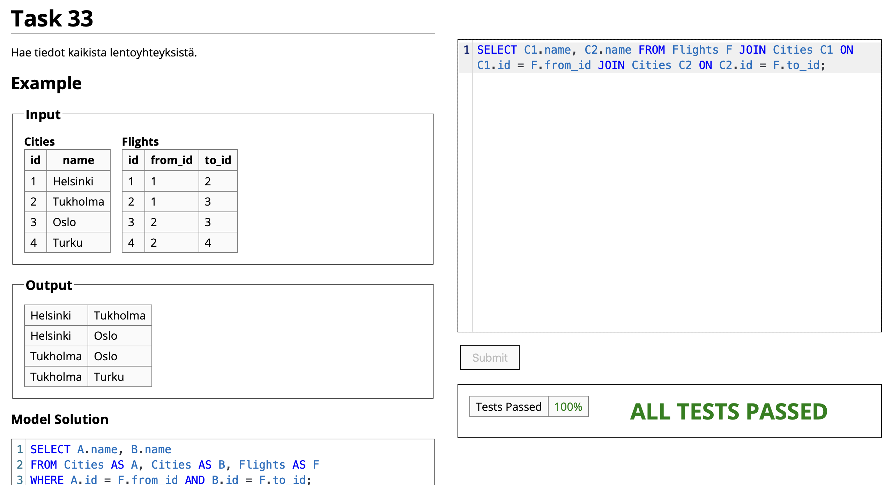
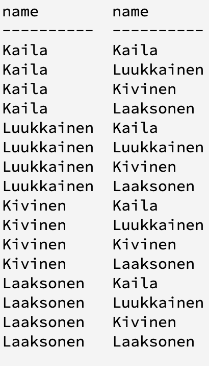
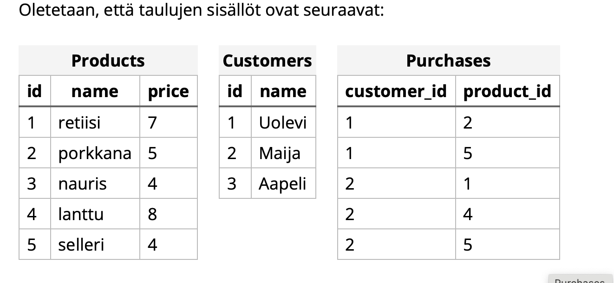

Samaan tauluun viittaus yhdessä kyselyssä:

- Jos haluaa viitata samaan tauluun yhden kyselyn aikana täytyy taulu nimetä kahdella tavalla

- Mallivastauksessa taulu Cities on nimetty A:ksi ja B:ksi

``` sql
SELECT A.name, B.name FROM Teachers A, Teachers B;
```

Hakee kaikki mahdolliset nimien parit taulusta Teachers



<br>

## Liitostaulut



Liitostaululla voi yhdistää kaksi toisiinsa liittyvää tauluja id-numeroiden avulla
